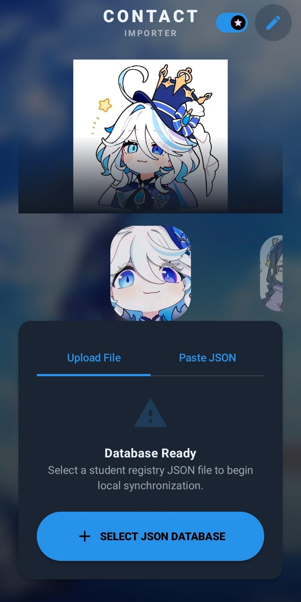
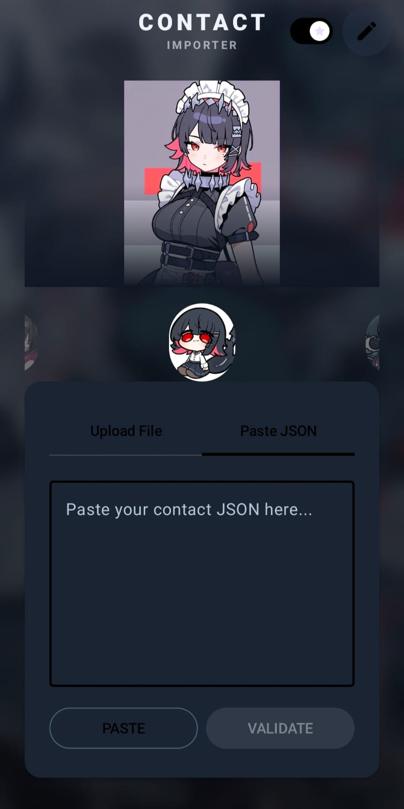
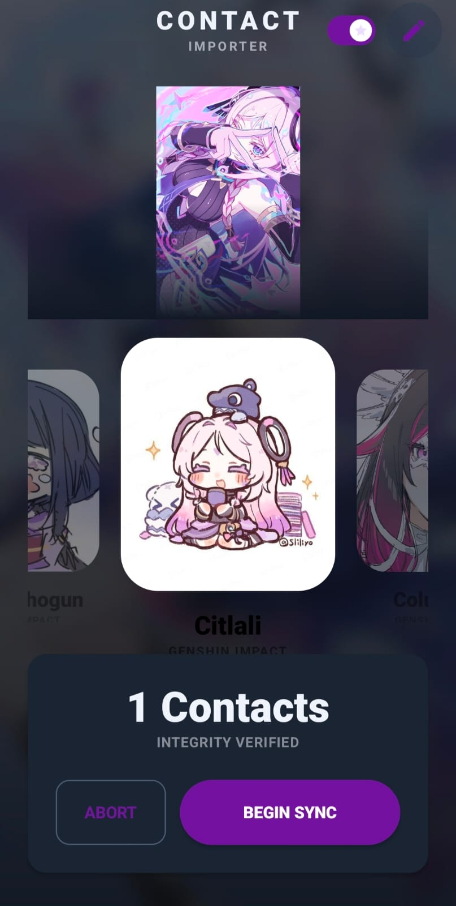
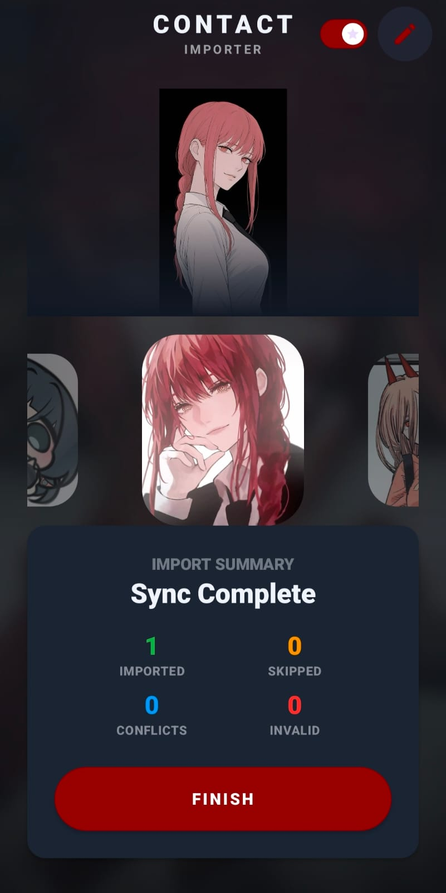

# CONTACT IMPORTER

<p align="center">
  <strong>A modern, lightweight Android application for importing contacts from JSON with speed, reliability, and a polished Material 3 experience.</strong>
</p>

<p align="center">
  
  
  
  
</p>

---

## Overview

**CONTACT IMPORTER** is an Android application that imports contacts directly into the device's Contacts Provider from JSON files or pasted JSON text.

The application is designed around three core principles:

* **Fast** — Handles thousands of contacts efficiently.
* **Reliable** — Fault-tolerant parsing with duplicate detection.
* **Beautiful** — A customizable Material 3 interface with optional character themes.

Unlike many contact importers, all processing happens **locally on the device**. No accounts, cloud storage, analytics, or external servers are required for importing contacts.

---

# Features

### JSON Import

* Import from `.json` files
* Paste JSON directly into the app
* Automatic format detection
* Supports large contact lists

---

### Flexible JSON Support

Supports:

* Root arrays
* Single JSON objects
* Wrapped objects

```json
{
  "contacts": [...]
}
```

```json
{
  "data": [...]
}
```

```json
{
  "items": [...]
}
```

Wrapper names are **case-insensitive**.

---

### Flexible Contact Fields

Accepted name fields

* `name`

Accepted phone fields

* `number`
* `phone`

Case-insensitive.

Example:

```json
{
  "Name": "Furina",
  "PHONE": "+919876543210"
}
```

---

### Multiple Value Types

Phone numbers may be:

```json
"number": "+919876543210"
```

or

```json
"number": 9876543210
```

Numbers are internally converted to **String** to preserve formatting whenever possible.

---

### Intelligent Validation

Every contact is validated individually.

If one contact is invalid:

* It is skipped
* Remaining contacts continue importing

The entire import never fails because of a single malformed record.

---

### Duplicate Detection

Duplicates are detected using normalized phone numbers.

Normalization removes formatting differences such as:

```
+91 98765 43210
```

```
98765-43210
```

```
9876543210
```

All resolve to the same normalized value.

Duplicate handling includes:

* Existing device contacts
* Duplicate entries inside the JSON file
* Conflict resolution before importing

---

### High Performance Batch Import

Designed to import large contact lists without freezing the UI.

Optimizations include:

* Background coroutines
* Batch `ContentProviderOperation`
* Efficient JSON parsing
* Memory-conscious processing
* Smooth progress updates

---

### Character Theme Engine

The UI supports customizable character themes while keeping the import engine completely independent.

Features include:

* Theme switching
* Dynamic color palettes
* Character artwork
* Lightweight asset loading
* Easy theme expansion through assets

Changing themes never affects importing functionality.

---

# Supported JSON Example

```json
[
  {
    "name": "Furina",
    "number": "+919876543210"
  },
  {
    "name": "Raiden Shogun",
    "phone": "+919876543211"
  }
]
```

---

# Import Pipeline

```text
JSON File / Paste
        │
        ▼
 Format Detection
        │
        ▼
 Parsing
        │
        ▼
 Validation
        │
        ▼
 Duplicate Detection
        │
        ▼
 Conflict Resolution
        │
        ▼
 Batch Import
        │
        ▼
 Android Contacts Provider
```

---

# Screenshots

| Home                                | Import                              |
| ----------------------------------- | ----------------------------------- |
|  |  |

| Theme Selection                     | Import Complete                     |
| ----------------------------------- | ----------------------------------- |
|  |  |

---

# Performance Goals

| Metric         | Target                          |
| -------------- | ------------------------------- |
| APK Size       | 25–35 MB                        |
| Maximum APK    | < 60 MB                         |
| Target Devices | Android devices with 2–4 GB RAM |
| UI Performance | 60 FPS                          |
| Large Imports  | No ANR / No UI Freeze           |

Performance optimizations include:

* Lazy loading
* Resource shrinking
* R8 optimization
* Minimal dependencies
* Efficient memory usage
* Background processing
* Fast startup
* Batched contact writes

---

# Tech Stack

* Kotlin
* Jetpack Compose
* Material 3
* Kotlin Coroutines
* kotlinx.serialization
* Android Contacts Provider
* Storage Access Framework (SAF)

No backend services are required for the core functionality.

---

# Project Structure

```text
app/
└── src/main/
    ├── java/
    │   └── com/example/contactimporter/
    │       ├── contacts/
    │       ├── data/
    │       ├── importer/
    │       ├── theme/
    │       └── ui/
    │
    ├── assets/
    │   └── characters/
    │
    └── res/
```

---

# Why CONTACT IMPORTER?

* Lightweight architecture
* Offline-first
* Robust JSON parsing
* Flexible import formats
* Duplicate detection
* Smooth Material 3 interface
* Extensible character theme engine
* Built with performance in mind

---

# Legal Notice

## Third-Party Character Artwork

This project may include artwork, images, names, logos, or other intellectual property associated with third-party games, anime, or entertainment franchises.

These assets:

* are **not owned** by the author of this repository;
* remain the property of their respective copyright and trademark holders;
* are included solely for **demonstration, educational, personal, and non-commercial showcase purposes** within this open-source project;
* are **not** intended to imply ownership, endorsement, sponsorship, or affiliation with the respective rights holders.

If you are a copyright owner and believe any content in this repository should not be displayed, please open an issue or contact the repository owner. The relevant content will be reviewed and removed if appropriate.

**Do not redistribute, reuse, or commercialize any third-party artwork included in this repository unless you have permission from the original copyright holder.**

---

# License

This project's source code is licensed under the **MIT License**.

Third-party artwork, logos, and character images are **not covered** by the MIT License and remain the property of their respective owners.

---

# Future Improvements

* CSV import support
* vCard (.vcf) import
* Search before import
* Undo recent imports
* Advanced duplicate merging
* Import statistics dashboard
* Material You dynamic theming
* Additional customizable themes

---

# Contributing

Contributions are welcome.

If you discover a bug, have an improvement, or would like to add new functionality, feel free to open an issue or submit a pull request.

---

<p align="center">

**Fast enough for low-end devices.**
**Flexible enough for real-world JSON.**
**Polished enough to feel like a finished Android application.**

</p>
